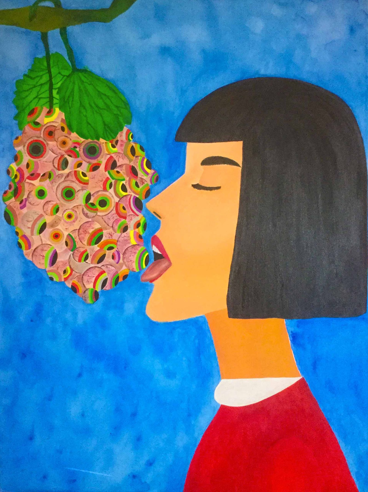
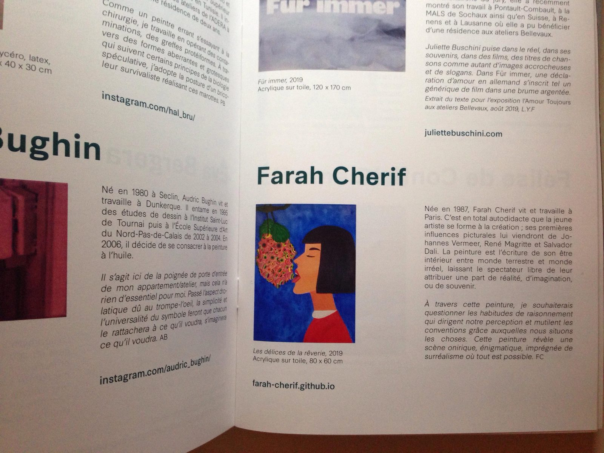

Collective exhibition
 

Artwork candidate for the November Painting Prize in Vitry 2019 and selected for a collective exhibition from November 16 to December 15 at the Municipal Gallery JEAN-COLLET of Vitry-sur-Seine.
 

